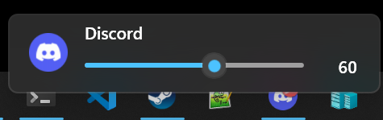
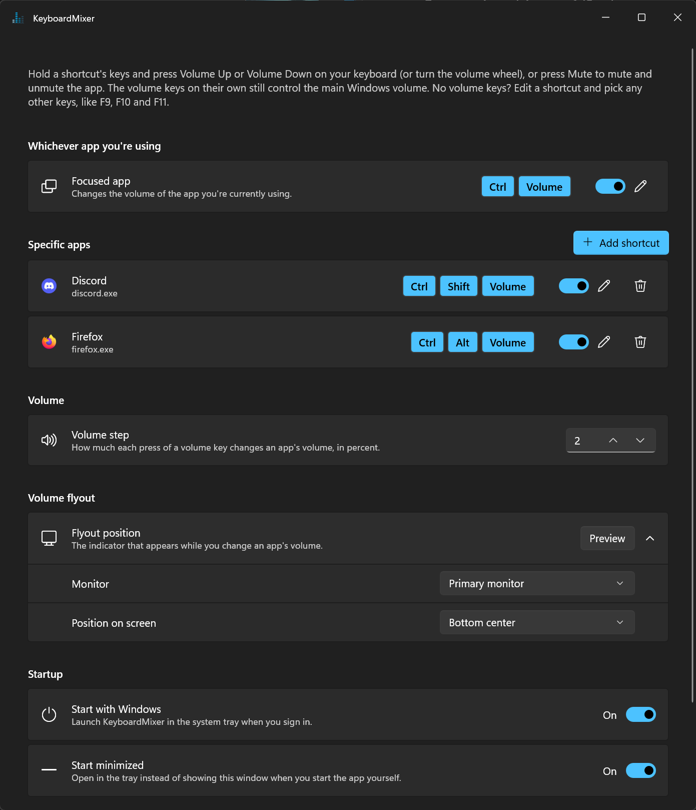

# KeyboardMixer

Change the volume of individual Windows apps with your keyboard's volume keys.

- **Ctrl + Volume Up/Down** changes the volume of the app you're using; **Ctrl + Mute** mutes or unmutes it.
- **Your own shortcuts** (for example Ctrl + Shift + Volume) always control one specific app, such as your music player or voice chat, whatever window is focused. They work with the Mute key too.
- The volume and mute keys on their own still control the main Windows volume.
- **No volume keys?** Any shortcut can use other keys instead, for example Ctrl + Alt + F9 / F10 / F11 for down, up and mute.

A small Windows 11-style flyout shows the app, its icon and its new volume level. KeyboardMixer runs quietly in the system tray and can start with Windows.

<p align="center">
  
</p>

<p align="center">
  
</p>

## Using it

Open settings from the tray icon (left-click, or right-click → **Open settings**). Everything is on one page:

- **Shortcuts**: the focused-app shortcut, plus your app shortcuts. Add one by picking from the apps currently playing audio, typing a program name, or browsing for an `.exe`. Each shortcut uses the volume keys by default; click a key in the shortcut dialog to record a different one.
- **Volume and flyout**: volume step (1–25%), flyout monitor and position, with a preview button.
- **Startup**: start with Windows, start minimized.
- **About**: version and settings file location.

Right-click the tray icon to **pause** all shortcuts or **exit**.

If a shortcut shows a ⚠ warning, another program already owns that key combination; choose different keys.

## How it works

- **Shortcuts use `RegisterHotKey`**, not a low-level keyboard hook. Windows only fires a hotkey on an exact modifier match and swallows the key, so there is no hook that Windows can silently remove, no key state to get "stuck", and Ctrl and Ctrl+Shift shortcuts never overlap. Each shortcut is modifiers (Ctrl, Alt, Shift, Win; left and right count the same) plus one key per action. Holding a non-modifier key (like CapsLock + Volume) isn't possible with `RegisterHotKey` and would need a keyboard hook, so it isn't supported. F13–F24 can be used without modifiers; other keys need at least one so they don't take over typing or the normal volume keys.
- **Volume** goes through the Windows Core Audio session API on a dedicated background thread. Sessions are collected from *every* active playback device and grouped by executable name, so multi-process apps (browsers, Discord, Spotify) change together.
- **Settings** are stored as JSON in `%LocalAppData%\KeyboardMixer\settings.json`. Diagnostics go to `log.txt` in the same folder.

## Installing

Download `KeyboardMixer-Setup-<version>.exe` from the [releases page](https://github.com/troyhayes/KeyboardMixer/releases/) and run it. It installs just for you (no admin prompt) to `%LocalAppData%\KeyboardMixer\app`, adds a Start menu shortcut, and lets you choose whether KeyboardMixer starts with Windows and whether it opens in the tray. To update, download the newer setup and run it: it closes KeyboardMixer if it's running, replaces it in place and keeps your settings and shortcuts. Uninstall from **Settings → Apps** removes the app but keeps your settings file (`%LocalAppData%\KeyboardMixer\settings.json`), so reinstalling brings your shortcuts back.

## Building

Requirements: Windows 10 19041+ and the [.NET 10 SDK](https://dotnet.microsoft.com/download). Visual Studio is optional.

```powershell
dotnet build                                   # whole solution (app builds as x64)
dotnet test tests/KeyboardMixer.Core.Tests     # unit tests
dotnet run --project src/KeyboardMixer         # launch the app
```

The app is a WinUI 3 app (Windows App SDK 1.8), **unpackaged and self-contained**: the build output folder runs as-is, with no MSIX. Release builds are also trimmed, and leave out the parts of the Windows App SDK the app doesn't use (its AI/ML runtime and Widgets), so the published app is about 80 MB instead of over 200 MB.

To build the installer (needs [Inno Setup 6](https://jrsoftware.org/isinfo.php): `winget install JRSoftware.InnoSetup`):

```powershell
./build-installer.ps1      # → artifacts\KeyboardMixer-Setup-<version>.exe (~21 MB)
```

For a new release, bump `<Version>` in `Directory.Build.props` first; the installer takes its version from the app.

Or just the app folder, to zip and share:

```powershell
dotnet publish src/KeyboardMixer -c Release -p:Platform=x64 -o publish
```

The installer talks to the app through command-line options: `--setup [--startup] [--minimized]` applies the install choices, `--exit` closes a running copy, `--uninstall` removes the startup entry, and `--show` opens the settings window.

### Layout

```
src/KeyboardMixer.Core/    Audio sessions, settings, shortcut model/validation, placement math (no UI, unit-tested)
src/KeyboardMixer/         WinUI 3 app: tray icon, hotkeys, flyout, settings window
installer/                 Inno Setup script
tests/                     xUnit tests for KeyboardMixer.Core
```
